# NEXUS GEAR

> 一个品牌化的电脑外设商城前端项目，使用 Vue 3 从零搭建。涵盖商品浏览、搜索筛选、收藏、购物车、结算下单、订单管理等完整的前台购物流程，并实现本地持久化与交互动效优化。

本项目为**前端练手 / 作品集项目**，商品数据为前端静态数据，订单与购物车基于 `localStorage` 持久化，不涉及真实支付与后端接口。

---

## 项目简介

NEXUS GEAR 是一个面向游戏玩家、程序员和桌搭爱好者的电脑外设商城。项目以「深色科技风 + 荧光绿品牌色」为视觉基调，构建了一个体验完整的单页应用（SPA）。

用户可以从首页开始，完成「浏览 → 筛选 → 看详情 → 收藏 / 加购 → 结算 → 下单 → 查看订单」的完整购物闭环。

---

## 技术栈

| 类别 | 技术 |
|------|------|
| 框架 | Vue 3（Composition API + `<script setup>`） |
| 构建工具 | Vite |
| 状态管理 | Pinia |
| 路由 | Vue Router |
| 样式 | 原生 CSS（CSS 变量 + Flexbox + Grid + 响应式） |
| 数据持久化 | `localStorage` |

---

## 功能特性

### 商品浏览
- 首页：Hero 主视觉、精选好物、分类推荐、品牌故事、服务保障、品牌动态
- 商品列表：分类筛选、关键词搜索、价格区间筛选、多维度排序
- 商品详情：规格参数、数量选择、图片大图预览、相关推荐、最近浏览

### 购物流程
- 购物车：增减数量、删除、清空、订单摘要
- 结算页：收货信息表单 + 校验（含手机号正则校验）
- 订单：生成订单快照、订单列表、订单详情

### 用户相关（本地）
- 收藏商品
- 搜索历史
- 最近浏览记录

### 交互与体验
- 加入购物车「飞入购物车」动画
- 全局 Toast 消息提示
- 自定义确认弹窗
- 图片大图预览（支持 Esc 关闭、点击遮罩关闭）
- 面包屑导航、回到顶部、页面切换过渡动画
- 响应式布局（适配桌面 / 平板 / 手机）

---

## 快速开始

### 环境要求

- Node.js ≥ 18
- npm / pnpm / yarn 任选其一

### 安装依赖

```bash
npm install
```

### 启动开发服务器

```bash
npm run dev
```

启动后，在浏览器中打开终端提示的本地地址（默认 `http://localhost:5173`）。

### 构建生产版本

```bash
npm run build
```

构建产物输出到 `dist/` 目录。

### 本地预览构建产物

```bash
npm run preview
```

---

## 页面展示

> 以下为项目主要页面的实际截图，图片存放在 `项目截图/` 目录下。

---

### 首页（HomeView）

包含 Hero 主视觉（Glitch 标题 + 浮动商品卡片）、精选好物、分类推荐、品牌故事、服务保障、品牌动态等区块。

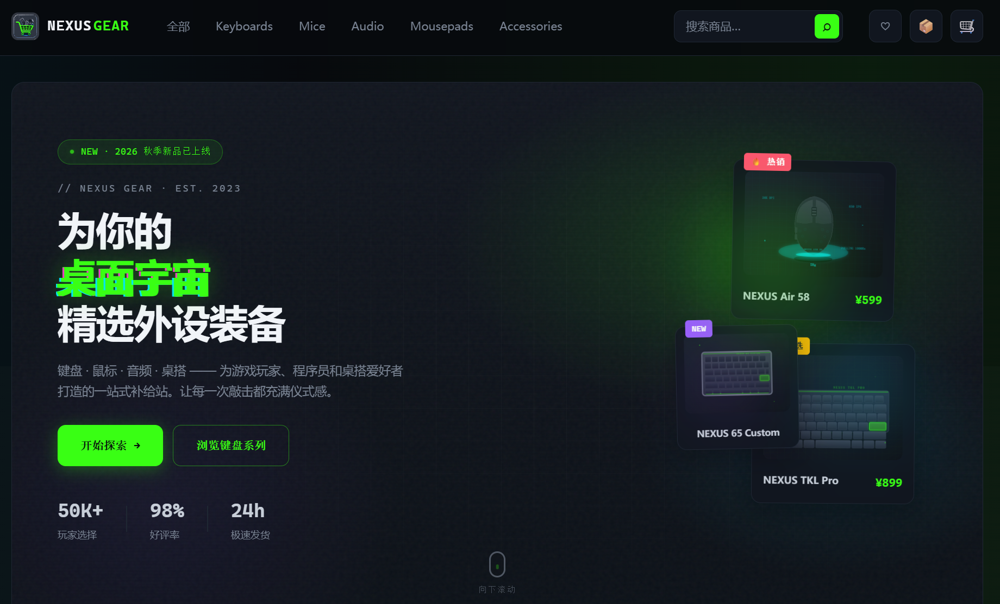

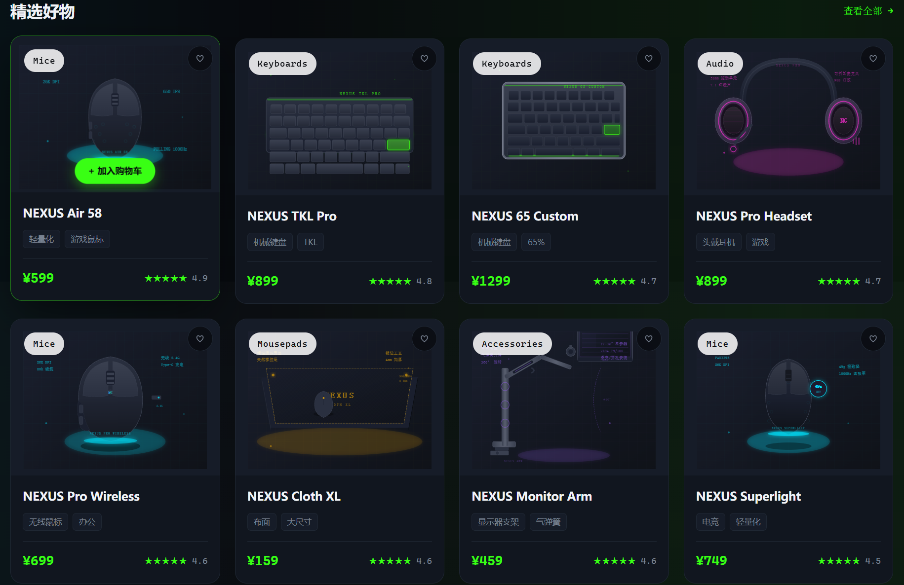

---

### 商品列表页（ProductsView）

支持分类筛选、关键词搜索、价格区间（双滑块）筛选、排序（价格 / 评分），筛选条件全部同步到 URL，刷新不丢。

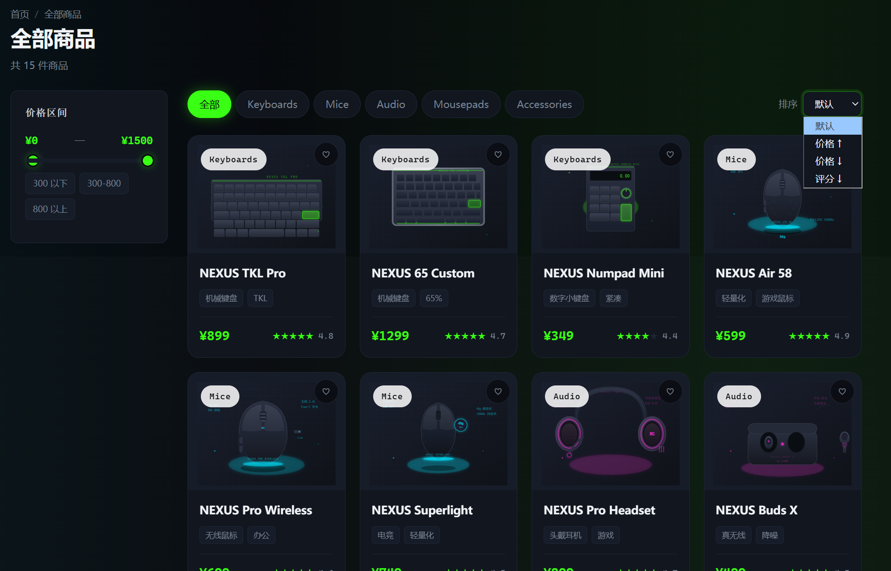

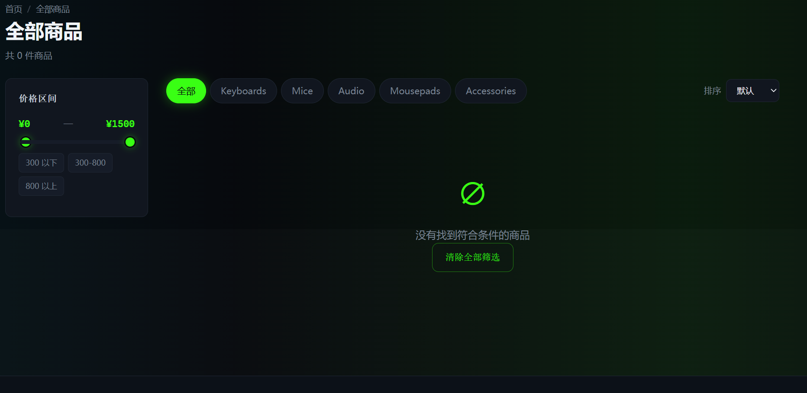

---

### 商品详情页（ProductDetailView）

根据 URL 中的 `slug` 动态展示商品，含规格、数量选择、收藏、加入购物车、相关推荐、最近浏览、图片大图预览。

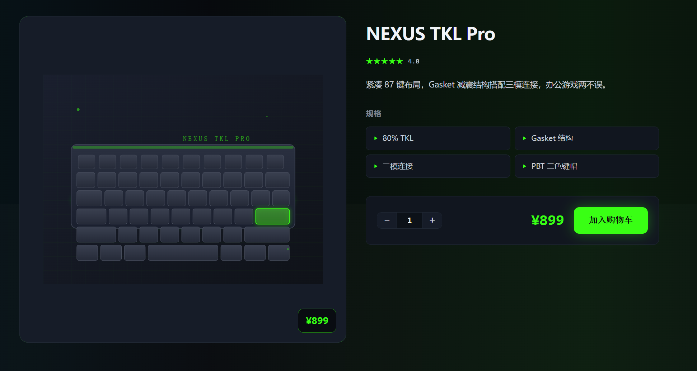

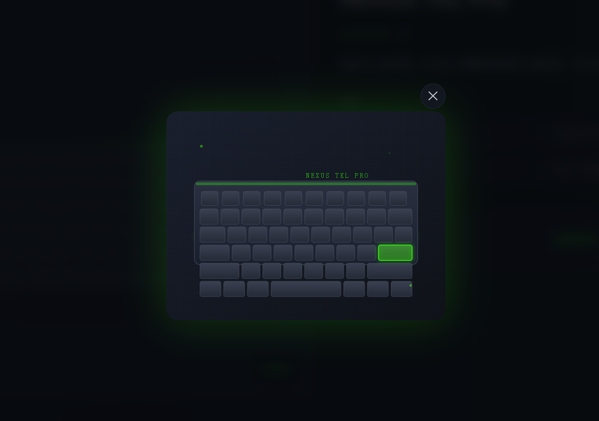

---

### 购物车页（CartView）

展示商品清单、数量修改、删除、清空、订单摘要与「去结算」。

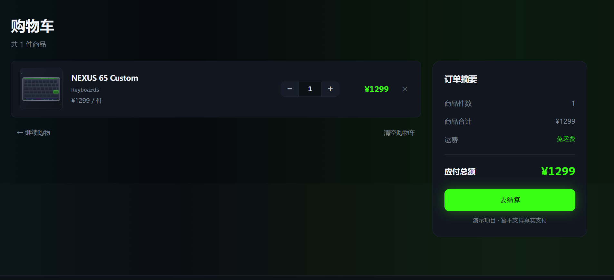

---

### 结算页（CheckoutView）

收货信息表单（含姓名、手机号、地址、备注）与校验，提交后生成订单。

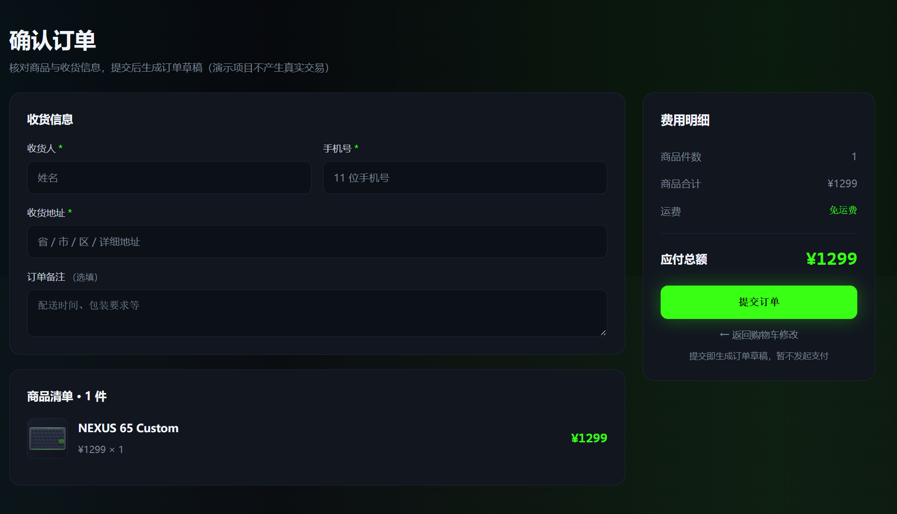

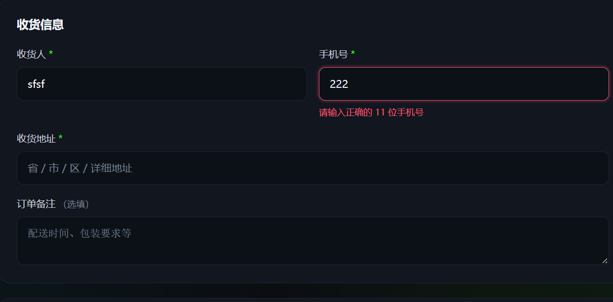

---

### 订单页（OrdersView / OrderSuccessView）

订单列表按时间倒序展示，订单详情展示收货信息、商品清单、金额汇总（手机号脱敏）。

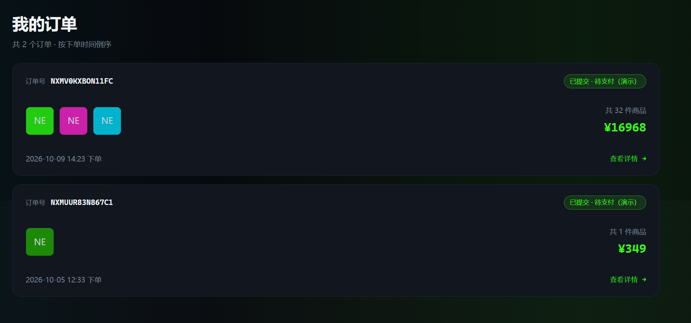

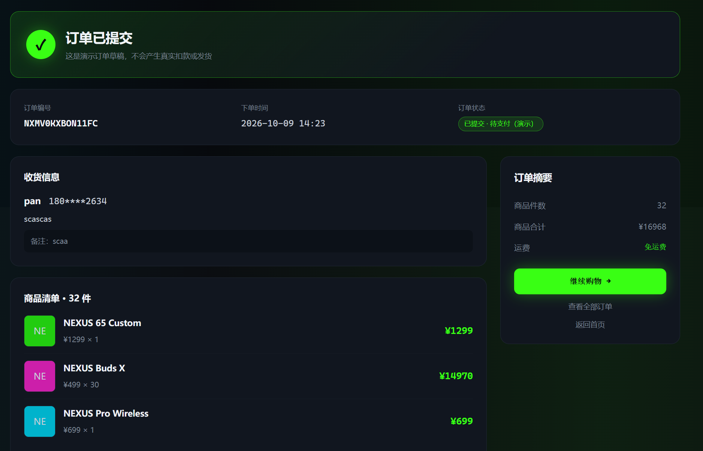

---

### 收藏页（FavoritesView）

展示已收藏的商品，支持清空收藏。

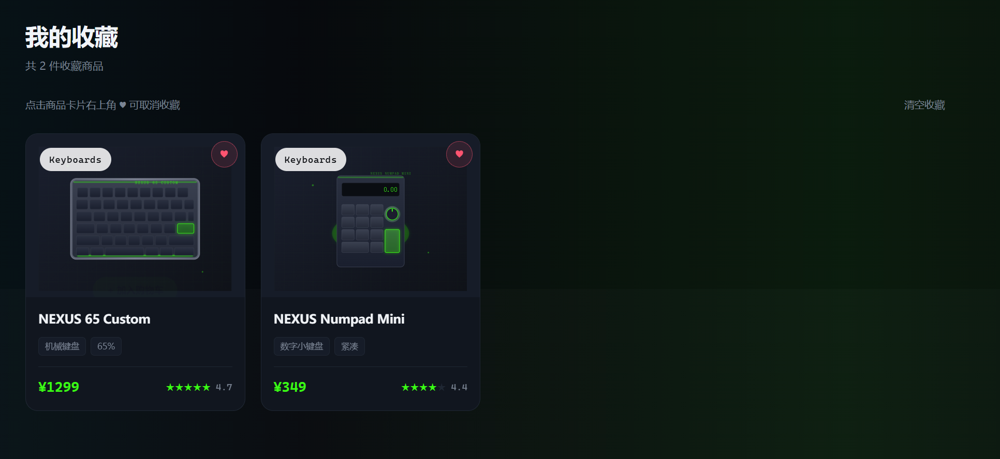

---

### 交互细节

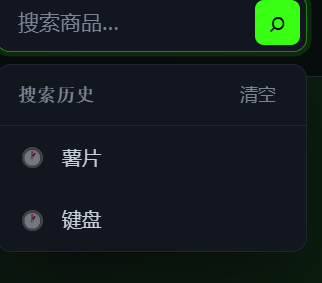

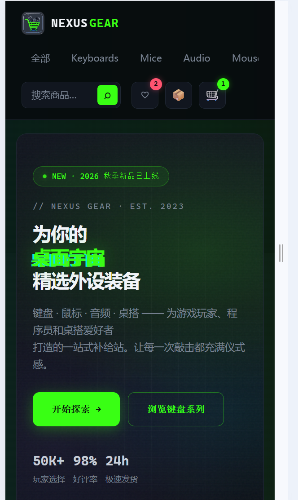

---

## 项目结构

```
nexus-gear/
├── index.html                  # 应用入口 HTML
├── package.json                # 依赖与脚本
├── vite.config.js              # Vite 构建配置
└── src/
    ├── main.js                 # 应用启动入口
    ├── App.vue                 # 应用外壳（Header + 内容区 + Footer）
    ├── style.css               # 全局样式（CSS 变量 + 主题）
    ├── router/
    │   └── index.js            # 路由配置与页面标题
    ├── data/
    │   └── products.js         # 商品与分类静态数据
    ├── stores/                 # Pinia 状态管理
    │   ├── index.js            # Pinia 实例
    │   ├── cart.js             # 购物车
    │   ├── favorite.js         # 收藏
    │   ├── order.js            # 订单
    │   ├── recent.js           # 最近浏览
    │   ├── searchHistory.js    # 搜索历史
    │   └── toast.js            # 全局消息提示
    ├── views/                  # 页面组件
    │   ├── HomeView.vue
    │   ├── ProductsView.vue
    │   ├── ProductDetailView.vue
    │   ├── CartView.vue
    │   ├── CheckoutView.vue
    │   ├── OrdersView.vue
    │   ├── OrderSuccessView.vue
    │   ├── FavoritesView.vue
    │   └── NotFoundView.vue
    ├── components/             # 可复用组件
    │   ├── AppHeader.vue
    │   ├── AppFooter.vue
    │   ├── ProductCard.vue
    │   ├── Breadcrumb.vue
    │   ├── ImagePreview.vue
    │   ├── ConfirmDialog.vue
    │   ├── ToastContainer.vue
    │   └── BackToTop.vue
    └── utils/
        └── flyToCart.js        # 飞入购物车动画
```

---

## 核心实现说明

### 1. 商品数据与购物车

购物车只存 `{ id, qty }`，商品完整信息通过 `id` 实时从 `products.js` 派生。这样做的好处是：数据更轻，商品信息变更后购物车不会保留过期数据。

```js
const detailedItems = computed(() =>
  items.value.map((it) => {
    const product = products.find((p) => p.id === it.id)
    return product ? { ...product, qty: it.qty, subtotal: product.price * it.qty } : null
  }).filter(Boolean)
)
```

### 2. 订单快照

下单时对商品信息做快照复制，而非引用购物车。保证商品后续改价 / 下架不会影响历史订单。

### 3. 状态持久化

购物车、收藏、订单、最近浏览、搜索历史均通过 `watch` + `localStorage` 自动持久化，刷新后数据不丢失。

### 4. URL 即状态

商品列表页的分类、搜索、价格、排序条件全部同步到 URL query，刷新可还原、可分享链接。

### 5. 组件通信

- 父子局部交互使用 `props` / `emit`（如 `ProductCard` 传商品、发 `added` 事件）
- 跨页面共享状态使用 Pinia（购物车、收藏、订单）
- 双向绑定使用 `v-model`（如 `ImagePreview` 的 `v-model:visible`）

### 6. 原生 JS 动画

「加入购物车」飞入动画不依赖动画库，使用 `getBoundingClientRect` 定位 + `requestAnimationFrame` 循环 + 缓动函数实现。

---

## 可改进方向

- 接入真实后端 API，替换静态数据
- 增加用户系统（登录 / 注册 / 权限）
- 完善订单状态流转（待支付 / 已支付 / 已发货 / 已完成）

项目仅用于个人学习与作品集展示，不含真实交易。
